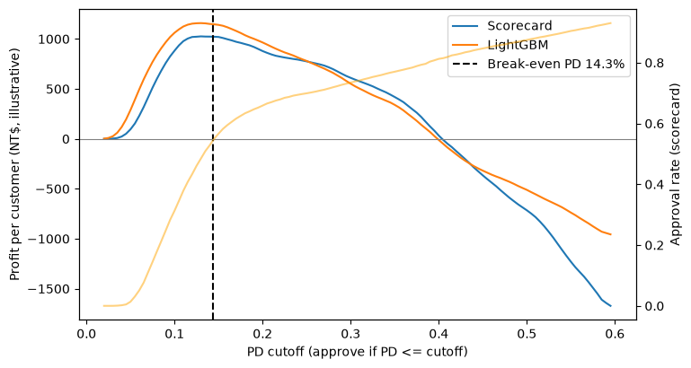

# Credit Risk Scorecard & Profit-Optimal Approval Strategy

PD scorecard, machine learning challenger models, and profit-optimal credit decision strategy.

**Key result:** Using an illustrative break-even PD of 14.3%, the WOE scorecard earned NT$876 per customer on the held-out test set, compared with a loss of NT$3,259 when approving everyone. The paired profit gain was NT$4,136 per customer (95% CI: NT$3,857–4,437). The monotonic LightGBM challenger delivered a paired-bootstrap mean uplift of NT$201 per customer (95% CI: NT$87–313). **Recommendation: retain the scorecard as champion and evaluate LightGBM through a controlled pilot.**

## 1. Business Problem

Credit card lenders face a trade-off between losses caused by customer defaults and revenue lost when credit is unnecessarily restricted.

This project investigates how historical repayment behaviour can be used to estimate next-month default risk and develop a risk-based credit decision strategy.

**Primary business question:** Which decision threshold maximizes expected profit under explicitly defined assumptions about revenue, default losses, and operating costs?

## 2. Project Objectives

The project aims to:

1. Estimate the probability of next-month default for existing credit card customers.
2. Develop an interpretable, points-based credit risk scorecard.
3. Compare the scorecard with machine learning challenger models.
4. Evaluate ranking performance, calibration, and stability.
5. Identify a profit-optimal decision threshold under illustrative economic assumptions.

## 3. Dataset and Population

The project uses the UCI Default of Credit Card Clients dataset, containing approximately 30,000 customer records from Taiwan in 2005.

Each observation represents an existing credit card customer with historical billing, payment, repayment-status, and demographic information.

The observation period covers April–September 2005, with the target outcome recorded for October 2005. Exact variable-to-month mappings will be verified against the original dataset documentation.

**Dataset source:** UCI Default of Credit Card Clients. Add the official dataset URL when finalising the repository.

Expected project file location: `data/credit_card_default.csv`.

## 4. Target Definition

The binary target is `DEFAULT` in the cleaned dataset. The original UCI column is commonly named `default.payment.next.month`.

- `DEFAULT = 1`: Default recorded in the target month.
- `DEFAULT = 0`: No default recorded in the target month.

The actual default rate will be calculated and reported during exploratory data analysis.

The target represents a one-month outcome and must not be interpreted as a 12-month probability of default.

## 5. Observation and Performance Windows

- **Observation window:** April–September 2005.
- **Conceptual decision point:** End of September 2005.
- **Performance window:** October 2005.

Predictive features must use only information available at the conceptual decision point. Information from the performance window or subsequent events must not be used as input features.

## 6. Modelling and Evaluation

The planned modelling workflow is:

1. Problem definition and data audit.
2. Exploratory data analysis (EDA) and feature engineering.
3. Weight of Evidence (WoE) / Information Value (IV) logistic regression scorecard.
4. XGBoost or LightGBM challenger model with SHAP-based interpretation.
5. Model validation using Gini, KS, calibration, and Population Stability Index (PSI).
6. Profit-optimal threshold selection and sensitivity analysis.

The project will evaluate predictive performance separately from business value. Threshold selection will use clearly defined economic assumptions and will be evaluated on data not used to tune the threshold.

Proposed metric ranges are evaluation guidelines, not guaranteed results.

## 7. Fairness and Responsible Lending

Variables such as `SEX`, `AGE`, and `MARRIAGE` require careful consideration in credit-risk modelling.

The planned approach is to exclude `SEX` and `MARRIAGE` from the final model and investigate whether including `AGE` materially changes performance. Their use in a real lending system would require jurisdiction-specific legal and policy review.

Exploratory analysis may examine these variables to investigate potential disparities. Removing demographic variables does not automatically eliminate bias because other variables may act as proxies.

## 8. Assumptions and Limitations

### Assumptions

1. Revenue and loss figures used in the economic analysis are illustrative because the dataset does not contain actual profit data.
2. The treatment of repayment-status value `-2` will be verified against the dataset documentation before assigning a business interpretation.
3. Currency amounts will be used as recorded in the source dataset, with units documented and verified.

### Limitations

1. The data represents a particular credit-card population in Taiwan in 2005 and may not generalise to current customers or other markets.
2. The dataset has a single target period, limiting genuine out-of-time validation. A stratified random split can assess performance within the historical sample but does not establish future temporal stability.
3. The target covers one month rather than a longer default horizon.
4. Reject inference is not addressed. Outcomes for rejected applicants are unavailable, so results for existing cardholders may not generalise to the entire applicant population.
5. This is a behavioural scorecard for existing customers, not an application scorecard for new applicants.
6. The simplified approve/decline framework in the economic analysis is a proxy for credit-exposure decisions, not a validated real-world lending policy.
7. Predictive relationships do not establish causation, and model performance alone does not establish fairness or regulatory compliance.

## 9. How to Run

Create the project environment using Conda:

```bash
conda create -n credit-risk python=3.11
conda activate credit-risk
pip install -r requirements.txt
```

Open JupyterLab or Jupyter Notebook and run the notebooks in the documented project workflow.

Ensure that the dataset is stored in the expected location before running the analysis.

## 10. Headline Results

Headline result: On the locked test set, the scorecard achieved a Gini of 0.5176 (95% bootstrap CI: 0.4941–0.5434), while C3 Monotonic LightGBM achieved 0.5614 (0.5381–0.5847), a paired Gini improvement of 0.0438 (95% CI: 0.0343–0.0539).

See the [Model Card](reports/model_card.md) for model details, validation results, limitations, fairness assessment and monitoring recommendations.


## 11. Project Status

**Current stage:** Problem definition, data documentation, and exploratory data analysis.

Progress and results will be updated as the project develops.

### Key EDA Findings

- **Repayment status is the strongest signal:** PAY_0 has the highest univariate AUC (0.692), with higher delay codes associated with higher default rates.
- **Credit limit matters:** Default rates generally decline across higher credit-limit bands, from 36.9% in the lowest band to 11.6% in the highest.
- **Payment behaviour differs:** Non-defaulters made higher average payments than defaulters across all six months.
- **Bill amounts have weak standalone signals:** Their Spearman correlations with default are close to zero.
- **Historical deterioration matters:** Average repayment status worsened over time among customers who eventually defaulted.
- **Interactions may matter:** Repayment status and credit limit show potentially useful combined patterns.
- **Data quality decisions:** Duplicate profiles, negative bills and extreme values were investigated rather than automatically deleted.
- **Responsible modelling:** SEX and MARRIAGE are excluded from the final model; fairness still requires separate evaluation.

**Modelling implications:** Prioritise repayment history, investigate behavioural features and interactions, and compare an interpretable scorecard with machine-learning challengers.

## Feature Engineering

Created 49 candidate behavioural and profile features across five families:

- **Delinquency:** Payment delays, frequency, severity and repayment trends.
- **Utilization:** Credit usage relative to available credit limits.
- **Payment behaviour:** Payment ratios, zero-payment patterns and repayment coverage.
- **Bill dynamics:** Bill trends, changes and volatility.
- **Profile and combined features:** Age, education, account inactivity and a repayment-utilization interaction.

All features are generated using a reusable Python function applied consistently to training and testing data. The design avoids target leakage, uses fixed business rules for capping, and preserves undefined ratios as missing values.

## Evaluation Protocol

Model development and comparison use 5-fold stratified cross-validation on the training set. Preprocessing steps that learn from data, including imputation and scaling, are fitted within each fold to prevent information leakage.

The 30% test set is locked at Step 5, with file checksums recorded, and reserved for final evaluation in Step 8. Model performance is assessed using AUC, Gini, KS, Brier score, PSI, decile analysis and expected profit.

The dataset does not provide suitable dates for out-of-time validation. This limitation is documented.

## Step 6: Credit Risk Scorecard Development

Developed an interpretable credit-risk scorecard using Weight of Evidence (WOE) transformation and logistic regression.

### Variable selection
- Applied optimal binning and Information Value (IV) analysis.
- Removed low-information variables.
- Reduced redundancy using WOE correlation analysis.
- Checked multicollinearity using Variance Inflation Factor (VIF).
- Used backward elimination and L1 regularisation to compare variable selection.
- Retained nine predictors in the final scorecard:
  - Average repayment delay
  - Repayment delay trend
  - Number of revolving months
  - Log credit limit
  - Average payment amount
  - Average bill-to-limit ratio
  - Utilisation trend
  - Latest utilisation
  - Number of bill increases

### Model evaluation
Five-fold stratified cross-validation produced:

| Metric | Result |
|---|---:|
| AUC | 0.772 |
| Gini | 0.544 |
| KS | 0.425 |
| Brier Score | 0.139 |

The highest-risk decile had an actual default rate of 64.71%, compared with 5.29% in the lowest-risk decile.

### Scorecard construction
- Converted logistic regression coefficients and WOE values into additive score points.
- Used a base score of 600, base odds of 50:1 and PDO of 20.
- Verified that credit scores reproduce the logistic model's predicted probabilities.
- Verified that a 20-point increase halves the odds of default.

### Saved model artifacts
- `models/scorecard_model.joblib`
- `models/scorecard_config.json`
- `reports/scorecard_points.csv`
- `reports/final_feature_iv.csv`

The saved model was successfully reloaded and produced identical predictions to the original fitted model.

## Step 7: Machine Learning Challenger and Model Interpretation

### 1. Model tuning approach

Three LightGBM challenger models were developed and compared against the interpretable logistic regression scorecard:

- **C1:** LightGBM using the nine features selected for the scorecard.
- **C2:** LightGBM using all 48 engineered features, excluding age.
- **C3:** LightGBM using all 48 engineered features with monotonic constraints based on the expected direction of risk.

Hyperparameters were tuned using randomized search with 40 candidate configurations per model and five-fold stratified cross-validation. Early stopping was used to determine the number of boosting rounds. A one-standard-error selection approach was used to favour simpler configurations with competitive performance.

### 2. Nested cross-validation

Nested cross-validation was conducted for C3 using five outer folds and three inner folds. Hyperparameter tuning was performed within each outer training sample, and the selected model was evaluated on the corresponding untouched outer fold.

| Measure | Result |
|---|---:|
| Mean outer-fold AUC | 0.7907 |
| Mean outer-fold Gini | 0.5814 |
| Standard deviation of outer-fold Gini | 0.0172 |

The nested estimate provides an additional assessment of model generalisation while accounting for hyperparameter selection. The inner-loop selection used the best inner-fold AUC, rather than the one-standard-error selection rule used in the earlier tuning exercise.

### 3. Model calibration

Platt scaling and isotonic regression were assessed using fold-wise calibration.

Neither method produced a meaningful improvement for C3. Its original predictions achieved an AUC of 0.7896 and Brier score of 0.1327, compared with 0.7895 and 0.1328 after Platt scaling, and 0.7873 and 0.1331 after isotonic regression.

The original, uncalibrated C3 predictions were therefore retained. Calibration was treated as a separate assessment from ranking performance.

### 4. Model performance comparison

The following results are based on out-of-fold predictions on the training dataset.

| Model | AUC | Gini | KS | Brier | Top 10% default capture |
|---|---:|---:|---:|---:|---:|
| Scorecard | 0.7720 | 0.5439 | 0.4248 | 0.1388 | 29.26% |
| C1 LightGBM | 0.7839 | 0.5678 | 0.4369 | 0.1345 | 31.09% |
| C2 LightGBM | 0.7888 | 0.5776 | 0.4367 | 0.1328 | 32.19% |
| C3 Monotonic LightGBM | **0.7896** | **0.5792** | **0.4382** | **0.1327** | 31.95% |

C3 achieved the strongest overall AUC, Gini, KS and Brier results. C2 captured a slightly larger share of defaults in the highest-risk 10% of customers. The performance difference between C2 and C3 was small, while the scorecard remained the more interpretable model.

### 5. SHAP-based model interpretation

SHAP (SHapley Additive exPlanations) was used to interpret the final C3 model. Global feature importance identified the following influential variables:

1. Months since the most recent late payment
2. Latest repayment status
3. Maximum historical delay
4. Average repayment delay
5. Average bill amount
6. Average payment amount
7. Credit limit
8. Minimum payment ratio
9. Average utilisation over the latest three months
10. Number of monthly bill increases

The dependence plots indicated that recent and more severe repayment delays generally increased predicted default risk. Higher payment amounts and longer periods since the most recent late payment generally reduced predicted risk. Some billing and repayment variables showed more complex relationships.

SHAP values describe model contributions, not causal effects. They are useful for model interpretation and potential reason-code development, but should not be treated as proof that a particular customer characteristic causes default.

### 6. Step 7 conclusion

The monotonic LightGBM challenger achieved the strongest overall out-of-fold predictive performance, with only a modest improvement over the unrestricted LightGBM challenger. The logistic regression scorecard offers a simpler and more transparent alternative.

Both models were saved, and the saved C3 model was reloaded and verified against the original model, producing a maximum prediction difference of zero on the verification sample.

The credit approval strategies were evaluated on the held-out test dataset in Step 8, followed by the economic and profit-optimization analysis in Step 9 and the final business recommendation in Step 10.

## Economic Results and Profit-Optimal Strategy

Using illustrative assumptions of revenue R = NT$6,000, LGD = 70%, and EAD = NT$51,221, the break-even probability of default is **14.3%**. The corresponding scorecard cutoff is **538.71**.

On the 9,000-customer test sample, the scorecard strategy achieved an approval rate of 54.7% and profit of **NT$876.34 per customer**, compared with a loss of **NT$3,259.23 per customer** when approving everyone.

The paired bootstrap 95% confidence interval for the scorecard's profit advantage over approving everyone was **NT$3,856.50 to NT$4,437.10 per customer**. LightGBM generated an additional **NT$201.10 per customer** over the scorecard, with a paired 95% confidence interval of **NT$87.40 to NT$313.40**.

At equal approval rates of approximately 54.7%, LightGBM earned NT$1,049.74 per customer compared with NT$877.67 for the scorecard, an uplift of NT$172.07 per customer..

These results support retaining the interpretable scorecard as the champion and using monotonic LightGBM as a monitored challenger or pilot. All profit estimates are illustrative and depend on the assumed revenue and loss parameters.

### Strategy comparison on the test set

| Strategy | Approval rate | Bad rate approved | Profit/customer (NT$) |
|---|---:|---:|---:|
| Approve everyone | 100.0% | 22.1% | -3,259.23 |
| Decline everyone | 0.0% | — | 0.00 |
| Accuracy cutoff | 88.2% | 17.0% | -995.53 |
| Policy rule | 89.6% | 16.7% | -882.96 |
| Scorecard at break-even | 54.7% | 10.5% | 876.34 |
| LightGBM at break-even | 50.5% | 9.2% | 1,076.11 |

### Profit versus cutoff



### Sensitivity analysis

The sensitivity analysis shows that revenue has the largest impact among the tested economic assumptions. Across the two-way revenue × LGD grid, the largest regret from retaining the original fixed cutoff was approximately NT$1,180.60 per customer (at revenue NT$3,000 and LGD 90%).

